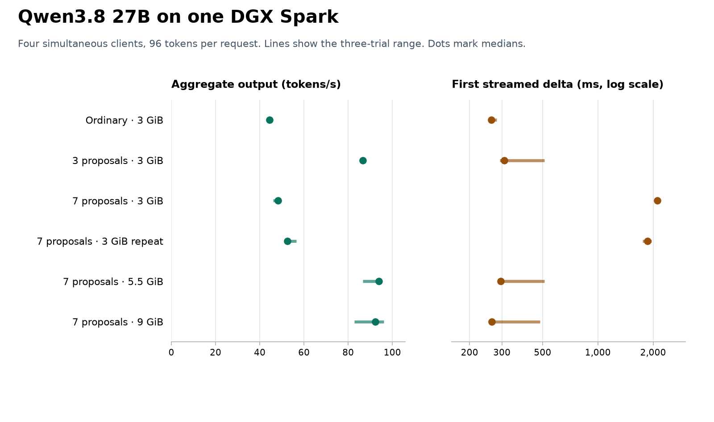

# KV memory and DFlash2 at four clients

On one GB10 we tested whether allocating more KV memory lets a seven-proposal drafter serve four short requests together. Every run used the same target, draft, runtime and 8,192-token request limit. Four sequence slots were enabled. Both original controls used a 3 GiB pool. [Depth comparison and model revisions](../)

With seven proposals, increasing KV memory from 3 to 9 GiB raised four-client throughput from **48.20 to 92.29 tok/s** and brought the median first streamed delta from **2.10 s to 264 ms**. GPU energy fell from 0.80 to 0.42 J/output token. The 9 GiB run scored 18/28 on short answers and 8/8 on lookups. At one client throughput stayed near 31 tok/s at both capacities.

At **5.5 GiB**, seven proposals delivered **93.86 tok/s at four clients**, with a 296 ms median first delta and 0.42 GPU J/token. Across the three trials, throughput ranged from 86.68 to 95.09 tok/s. All four requests ran together in every trial, with peak KV usage of 98.6%. The 5.5 GiB and original 3 GiB runs answered the same 19/28 questions correctly. The answer strings matched on 26/28 questions. Both passed all eight lookups. These capacity measurements apply to the short prompts and 96-token completions in this workload. [5.5 GiB recipe](../../../recipes/qwen38-27b-dflash-v033-7-kv5632m.json)

[Plot from per-trial measurements](plot.py)

| Run | KV GiB | Proposals | Reported KV token slots | Output tok/s, 1 / 4 | GPU J/token, 1 / 4 | Median first delta, ms, 1 / 4 | p95 first delta, ms at 4 | Short answers / 28 | Lookups / 8 |
| --- | ---: | --- | ---: | ---: | ---: | ---: | ---: | ---: | ---: |
| [Original three](../3/) | 3 | 3 | 17,264 | 25.34 / 86.54 | 1.46 / 0.42 | 174 / 309 | 310 | 19 | 8 |
| [Original seven](../7/) | 3 | 7 | 12,002 | 30.90 / 48.20 | 1.16 / 0.80 | 232 / 2105 | 4308 | 19 | 8 |
| [Larger KV pool](7-kv9/) | 9 | 7 | 36,006 | 30.85 / 92.29 | 1.14 / 0.42 | 235 / 264 | 265 | 18 | 8 |
| [Repeated control](7-kv3-repeat/) | 3 | 7 | 12,002 | 30.24 / 52.43 | 1.15 / 0.68 | 236 / 1868 | 3988 | 19 | 8 |
| [5.5 GiB pool](7-kv5632m/) | 5.5 | 7 | 21,972 | 30.38 / 93.86 | 1.13 / 0.42 | 237 / 296 | 296 | 19 | 8 |

## Larger KV pool

At four clients this run delivered 1.76× the throughput of the repeated control and changed GPU energy per generated token by -39.0%. It gained 0 and lost 1 correct short answers. The maximum observed number of running requests in the three repeats was 4, 4, 4. Maximum waiting counts were 0, 0, 0. [Per-trial scheduler samples](7-kv9/scheduler-trials.jsonl) · [Timed trials](7-kv9/trials.jsonl)

Peak sampled KV usage across the four-client trials reached 60.1% of the allocated pool.

## Repeated control

At four clients this run delivered 1.09× the throughput of the original seven and changed GPU energy per generated token by -14.7%. It gained 0 and lost 0 correct short answers. The maximum observed number of running requests in the three repeats was 2, 2, 2. Maximum waiting counts were 2, 2, 2. [Per-trial scheduler samples](7-kv3-repeat/scheduler-trials.jsonl) · [Timed trials](7-kv3-repeat/trials.jsonl)

Peak sampled KV usage across the four-client trials reached 90.4% of the allocated pool.

Inside the sampled trial windows, the engine reported 7.00 at 1 client, 7.00 at 4 clients proposed tokens per draft block. The counters use the first and last in-window samples and can omit boundary steps. [Observed proposal widths](7-kv3-repeat/observed-draft-widths.jsonl)

## 5.5 GiB pool

At four clients this run delivered 1.95× the throughput of the original seven and changed GPU energy per generated token by -47.5%. It gained 0 and lost 0 correct short answers. The maximum observed number of running requests in the three repeats was 4, 4, 4. Maximum waiting counts were 0, 0, 0. [Per-trial scheduler samples](7-kv5632m/scheduler-trials.jsonl) · [Timed trials](7-kv5632m/trials.jsonl)

Peak sampled KV usage across the four-client trials reached 98.6% of the allocated pool.

Inside the sampled trial windows, the engine reported 7.00 at 1 client, 7.00 at 4 clients proposed tokens per draft block. The counters use the first and last in-window samples and can omit boundary steps. [Observed proposal widths](7-kv5632m/observed-draft-widths.jsonl)

Each rate and latency is a median across three trials. Each trial submitted four 96-token prose requests after an excluded warm-up. GPU energy uses the cumulative NVML counter. The scheduler was polled every 250 ms during the new runs. [Sampler](../sample_metrics.py)

## Why four clients queue at 3 GiB

The 3 GiB rerun admitted two requests and queued two in all three trials. Its four-client rate was 52.43 tok/s, compared with 48.20 in the original run. The endpoint reported 189 GPU blocks, an 832-token attention block, an 8,192-token recurrent-state block and FP32 recurrent state. vLLM reserves block zero. At one client the pool was 45.21% occupied, or 85 of the 188 usable blocks. The four-client trials peaked at 170 blocks. [Effective runtime configuration](7-kv3-repeat/effective-cache.json) · [Repeated control](7-kv3-repeat/scheduler-trials.jsonl)

The same 41-token prompts and 96-token completions occupied 85 blocks per active request at 5.5 and 9 GiB. The repeated control fixes the engine’s conversion between its reported token slots and pooled blocks, giving 346 total blocks at 5.5 GiB and 567 at 9 GiB. Under a fixed number of bytes per block, these three measurements put the four-request threshold between **5.405 and 5.413 GiB**. Before the 5.25 GiB serving test we predicted that three requests would run and the fourth would wait. Longer prompts, different draft depths and other cache types require their own measurement. [Recompute the prediction](predict_slots.py) · [5.25 GiB forecast](predicted-5376m.json) · [vLLM capacity calculation](https://github.com/vllm-project/vllm/blob/v0.33.0/vllm/v1/core/kv_cache_utils.py#L1061-L1128) · [Reserved block and usage](https://github.com/vllm-project/vllm/blob/v0.33.0/vllm/v1/core/block_pool.py#L921-L932)

## Reproduce

From `inference-recipes/`, prepare and serve `qwen38-27b-dflash-v033-7-kv9`. Use the matched prose, question and lookup commands from the depth comparison with that alias. [9 GiB launch configuration](../../../recipes/qwen38-27b-dflash-v033-7-kv9.json) · [Benchmark commands](../#reproduce)
