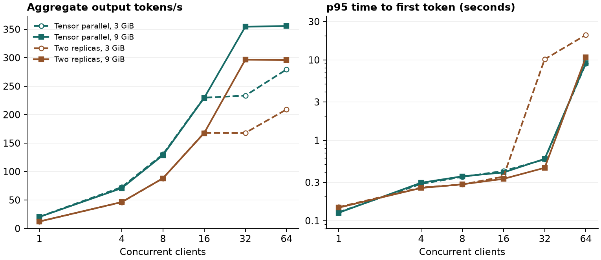

# Two replicas or one tensor-parallel Qwen3.8 27B endpoint?

On two DGX Sparks, one tensor-parallel Qwen3.8 27B endpoint delivered the most output tokens per second at every tested load. With 9 GiB of KV cache on each Spark, **32 clients reached 354.39 tok/s at 0.21 GPU J/token**. Two independent replicas reached 296.47 tok/s at 0.25 GPU J/token and started responding sooner at the 95th percentile, 455 ms against 587 ms. At 64 clients the sharded endpoint led on both throughput and first-token latency. [Launcher and replay](../../experiments/qwen-pair-serving/)

## 3 GiB KV per Spark

| Clients | Replicas tok/s | TP2 tok/s | Replicas p95 first token, ms | TP2 p95 first token, ms | Replicas GPU J/token | TP2 GPU J/token |
| ---: | ---: | ---: | ---: | ---: | ---: | ---: |
| 1 | 12.22 | 20.50 | 148 | 128 | 3.86 | 3.52 |
| 4 | 46.13 | 72.64 | 258 | 287 | 1.50 | 1.00 |
| 8 | 88.09 | 130.31 | 282 | 351 | 0.78 | 0.56 |
| 16 | 168.01 | 229.80 | 353 | 415 | 0.41 | 0.32 |
| 32 | 167.89 | 233.33 | 10,189 | 579 | 0.43 | 0.32 |
| 64 | 209.08 | 279.40 | 20,466 | 8,999 | 0.35 | 0.27 |

Each row reports the median of three trials. Latency is the median of the three within-trial p95 values. At 4–64 clients the client issues one simultaneous burst per trial. At one client it sends four requests sequentially, alternating between replicas. Each prose request returns 96 tokens. Aggregate throughput includes queueing, prefill and decode. Short prompts, burst size and output length matter when applying these numbers to a live service. [Replica trials](3g/replicas/trials.jsonl) · [TP2 trials](3g/tp2/trials.jsonl) · [Replica requests](3g/replicas/requests.jsonl.gz) · [TP2 requests](3g/tp2/requests.jsonl.gz)

On a fresh replica launch we repeated 32 clients first, then eight. The pair reached 168.39 and 89.03 tok/s, against 167.89 and 88.09 in the original sweep. Each deployment used 32 total scheduler slots, 8K maximum context, disabled prefix caching, and the same mixed NVFP4/FP8 checkpoint. Each replica has its own 2,048-token batch budget. TP2 has one such budget. vLLM reported 36,278 KV tokens per 3 GiB replica. The reported slot ceiling alone does not determine queueing latency. [Repeat trials](3g/replicas-repeat/trials.jsonl) · [Effective settings](3g/replicas/settings.jsonl)

Replicas scored **19/28** free answers. TP2 scored **18/28**, gaining 1 correct and losing 2 relative to replicas. The two shapes produced identical answer text on 23/28 diagnostic questions and 2/384 prose requests. Exact lookups scored 8/8 and 8/8, respectively. One answer in each deployment reached the 16-token cap, on different questions. This single pass does not establish a general accuracy difference between placements. [Replica diagnostic](3g/replicas/quality.jsonl.gz) · [TP2 diagnostic](3g/tp2/quality.jsonl.gz) · [Replica lookups](3g/replicas/lookup.json) · [TP2 lookups](3g/tp2/lookup.json)

The benchmark client ran on the head. Replicas used one loopback API and one private ConnectX API. TP2 used a loopback API and two NCCL RoCE rails between ranks. Each TP2 rank sent and received about 126.5 GB of unicast RDMA payload over the workload. The independent replicas had zero RDMA payload. Other checkpoint transfers on the lab network continued during parts of the campaign. GPU energy integrates NVML counters from both Sparks over the client trial, including the idle replica at one client. Whole-system power requires an external meter. [TP2 counters](3g/tp2/rdma.json) · [Replica counters](3g/replicas/rdma.json) · [TP2 energy](3g/tp2/energy.jsonl) · [Replica energy](3g/replicas/energy.jsonl)

## 9 GiB KV per Spark

Both configurations kept their original scheduler slots and tripled their KV budget. We reversed the topology order, serving TP2 first. At 32 clients, the larger cache raised replica throughput by 76.6% and reduced replica p95 first-token latency from 10.19 s to 0.46 s. On TP2 it raised throughput by 51.9% while p95 first-token latency stayed near 0.59 s. The benefit appeared above 16 clients on this short-prompt workload. [Effective replica settings](9g/replicas/settings.jsonl) · [Effective TP2 settings](9g/tp2/settings.jsonl)

| Clients | Replicas tok/s | TP2 tok/s | Replicas p95 first token, ms | TP2 p95 first token, ms | Replicas GPU J/token | TP2 GPU J/token |
| ---: | ---: | ---: | ---: | ---: | ---: | ---: |
| 1 | 12.19 | 20.19 | 145 | 125 | 3.92 | 3.55 |
| 4 | 46.39 | 70.82 | 255 | 296 | 1.56 | 1.03 |
| 8 | 88.14 | 128.71 | 283 | 356 | 0.80 | 0.56 |
| 16 | 167.44 | 229.23 | 331 | 398 | 0.42 | 0.32 |
| 32 | 296.47 | 354.39 | 455 | 587 | 0.25 | 0.21 |
| 64 | 296.01 | 355.78 | 10,803 | 9,159 | 0.25 | 0.21 |

Replicas scored **19/28** free answers. TP2 scored **18/28**, gaining 0 correct and losing 1 relative to replicas. The two shapes produced identical answer text on 23/28 diagnostic questions and 1/384 prose requests. Exact lookups scored 8/8 and 8/8, respectively. [Replica trials](9g/replicas/trials.jsonl) · [TP2 trials](9g/tp2/trials.jsonl) · [Replica diagnostic](9g/replicas/quality.jsonl.gz) · [TP2 diagnostic](9g/tp2/quality.jsonl.gz)

At fixed placement, changing the KV budget retained all 28 correctness verdicts for replicas and 26/28 for TP2. The two changed TP2 verdicts offset one another. Across both budgets, each deployment answered all eight exact lookups correctly. These small diagnostics leave general accuracy unresolved. [3 GiB TP2 answers](3g/tp2/quality.jsonl.gz) · [9 GiB TP2 answers](9g/tp2/quality.jsonl.gz)

For short bursts on this checkpoint, use 9 GiB per Spark and TP2 when aggregate output or GPU energy per token is the priority. At 32 clients the independent pair traded 16% of TP2’s throughput for a 132 ms shorter p95 wait to the first token. At 64 clients, both choices queued requests beyond the 32 offered slots. TP2 reached 355.78 tok/s with 9.16 s p95, compared with 296.01 tok/s and 10.80 s for replicas. [Per-request replica timings](9g/replicas/requests.jsonl.gz) · [Per-request TP2 timings](9g/tp2/requests.jsonl.gz) · [Replica energy](9g/replicas/energy.jsonl) · [TP2 energy](9g/tp2/energy.jsonl)
